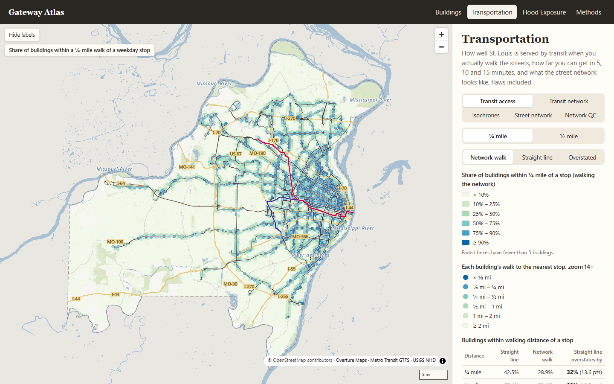
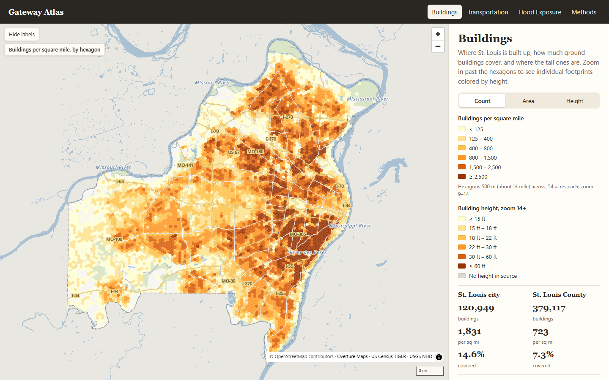
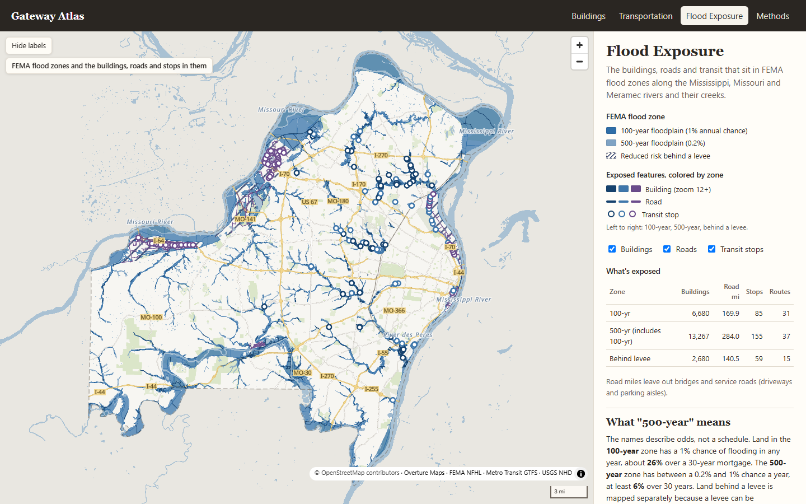
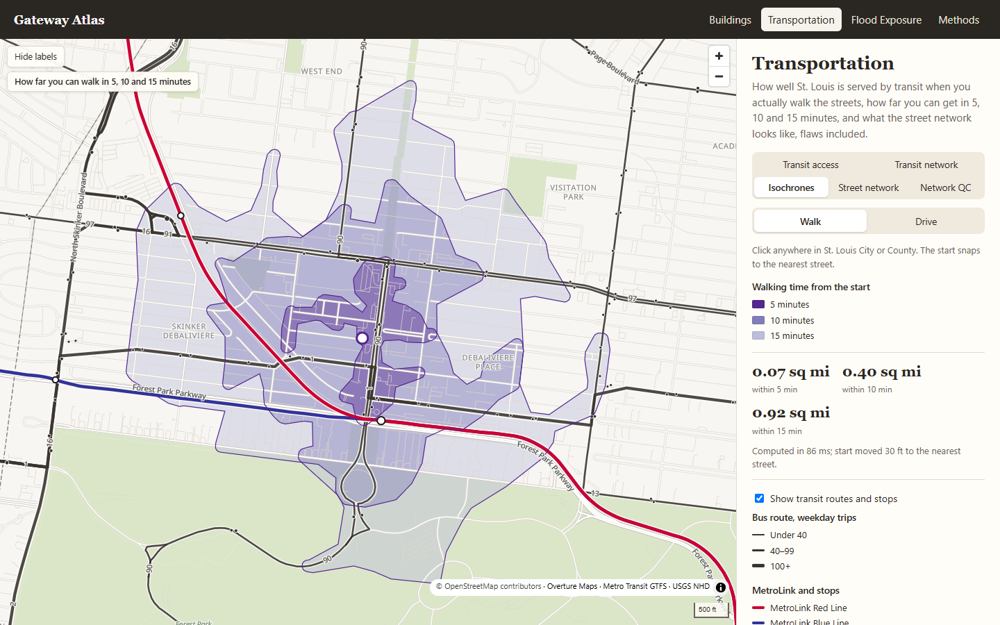
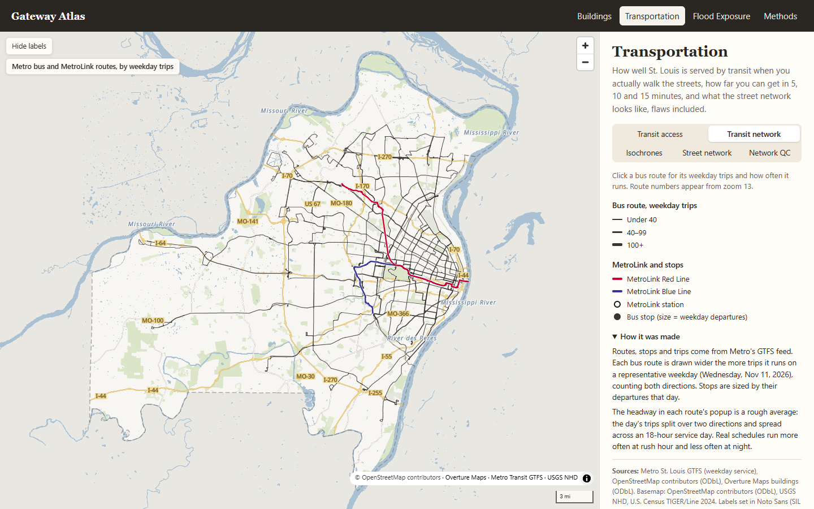
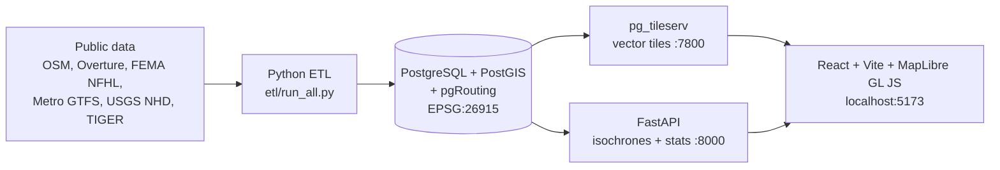

# Gateway Atlas

**St. Louis, mapped by Brody G.** Interactive web maps and spatial analyses of St. Louis City and County, built on a PostGIS database from public data.



- **Five analyses**, each one a plain SQL file in [`db/analysis/`](db/analysis/).
- **Live routing:** click the map and pgRouting computes a 5, 10 and 15-minute walk or drive area.
- **Built from the database up:** Python ETL, PostgreSQL/PostGIS + pgRouting, vector tiles, FastAPI, React + MapLibre GL JS.
- **Checked:** data QC, network QC and serving checks are all written to reports in [`docs/`](docs/).
- Study area: St. Louis City + St. Louis County, Missouri (about 590 sq mi). The site runs locally; it isn't hosted yet.

## What it shows

| Analysis | Headline |
|---|---|
| Transit walk access | Straight-line buffers overstate ¼-mile transit access by **32%** (42.5% of buildings vs. 28.9% by network walk, a 13.6-point gap). For the typical building, the walk to the nearest stop is about 1.4× the straight-line distance. |
| Isochrones | A 15-minute walk isochrone is computed live in **0.16 s or less** at every test point (the target was under 3 s). |
| Flood exposure | **6,680** buildings and 169.9 road miles touch FEMA's 100-year zone; **13,267** buildings and 284.0 road miles touch the 500-year zone (which includes the 100-year). |
| Building density | **500,066** footprints in hexagons about ⅓ mile across: 1,831 buildings per sq mi in the City vs. 723 in the County. |
| Street network | **48,417** intersections. Network QC flagged 40,309 dead ends, 56 crossings with no shared node and 784 one-way traps for review. |

Full numbers: [`docs/analysis-results.md`](docs/analysis-results.md).

## Screenshots

| | |
|---|---|
|  |  |
| **Buildings:** density, ground coverage and height by hexagon | **Flood exposure:** buildings, roads and transit stops in FEMA zones |
|  |  |
| **Isochrones:** 5, 10 and 15-minute walk from a clicked point in Skinker-DeBaliviere / DeBaliviere Place, by Forest Park | **Transit network:** Metro bus and MetroLink routes by weekday trips |

## Stack

| Layer | Tools |
|---|---|
| Data | OpenStreetMap (Geofabrik), Overture Maps buildings, FEMA NFHL, Metro St. Louis GTFS, USGS NHD, Census TIGER/Line |
| Database | PostgreSQL 18, PostGIS 3.6, pgRouting 4.0 |
| ETL | Python 3.11, GDAL/ogr2ogr, osm2pgsql, psycopg ([`etl/`](etl/)) |
| Serving | pg_tileserv (vector tiles), FastAPI (isochrones and stats, [`api/`](api/)) |
| Website | React 18, Vite 6, MapLibre GL JS 5 ([`web/`](web/)) |

All data is stored and analyzed in **EPSG:26915** (NAD83 / UTM zone 15N), so distances and areas are in true meters. The site shows them in miles, feet and square miles.

## Architecture



## Quick start (Windows)

The site runs locally. It isn't hosted yet.

**Prerequisites:** PostgreSQL 18 with the PostGIS 3.6 bundle from Stack Builder (includes pgRouting and GDAL), osm2pgsql, pg_tileserv, Python 3.11 and Node.js 20 or newer. [`docs/setup.md`](docs/setup.md) lists the exact versions and install steps.

1. Copy `.env.example` to `.env`. Set `PGPASSWORD`, and set `PG_BIN`, `OSM2PGSQL` and `PG_TILESERV` if your tools aren't at the defaults.
2. Follow [`docs/setup.md`](docs/setup.md) to create the Python environment, the `stl_gis` database and its extensions:
   ```powershell
   py -m venv .venv
   .venv\Scripts\python -m pip install -r requirements.txt
   powershell -ExecutionPolicy Bypass -File scripts\m1-verify.ps1
   ```
3. Load the data and run the analyses. The first run downloads about 600 MB and takes about 15 minutes. Rerunning is safe.
   ```powershell
   .venv\Scripts\python etl\run_all.py
   ```
4. Install the website packages:
   ```powershell
   cd web
   npm install
   cd ..
   ```
5. Start everything with one script. It checks PostgreSQL, then starts pg_tileserv, the API and the website. Ctrl+C stops it all.
   ```powershell
   powershell -ExecutionPolicy Bypass -File scripts\start.ps1
   ```
6. Open **http://localhost:5173**. API docs are at http://localhost:8000/docs.

## Repo layout

```
gis-portfolio/
├── api/          FastAPI app (isochrones, stats)
├── db/
│   ├── analysis/ the five analyses, in SQL
│   ├── qc/       data QC checks
│   └── serving/  read-only web roles, tile functions
├── docs/         setup guide, results and QC reports, screenshots
├── etl/          Python load scripts (run_all.py runs them in order)
├── scripts/      start.ps1, setup and serving checks
├── serving/      pg_tileserv config
├── web/          React + Vite + MapLibre site
└── data/         downloads (git-ignored)
```

## Data QC and checks

Each report is generated by a script, not written by hand.

- [`docs/data-qc.md`](docs/data-qc.md): geometry, SRID, row counts and study-area checks for every table (12 of 12 core tables pass).
- [`docs/network-qc.md`](docs/network-qc.md): routable network checks (4 of 4 pass), plus dead ends, islands, unnoded crossings and one-way traps flagged for review.
- [`docs/serving-check.md`](docs/serving-check.md): tile layers, API endpoints, isochrone speed, CORS and read-only database roles (15 of 15 pass).

## Data sources

| Layer | Source | License | Data date |
|---|---|---|---|
| Boundaries | U.S. Census Bureau TIGER/Line counties | Public domain | 2024 |
| Roads, paths, rail | OpenStreetMap via Geofabrik (Missouri extract) | ODbL | Extract of Nov 1, 2026 |
| Buildings | Overture Maps Foundation buildings theme | ODbL | Release 2026-10-21.0 |
| Transit | Metro St. Louis GTFS feed | Metro open data terms | Service Nov 2–29, 2026 |
| Flood zones | FEMA National Flood Hazard Layer | Public domain | Pulled Nov 2, 2026 |
| Water | USGS National Hydrography Dataset | Public domain | Downloaded Nov 2, 2026 |
| Label font | Noto Sans (Protomaps basemaps-assets) | SIL Open Font License | |

Map data © OpenStreetMap contributors. More detail is on the site's Methods page.

## License

Code is under the [MIT License](LICENSE). The data keeps its own source licenses, listed above.

## Contact

Brody G. Contact details are on the site's home page.
